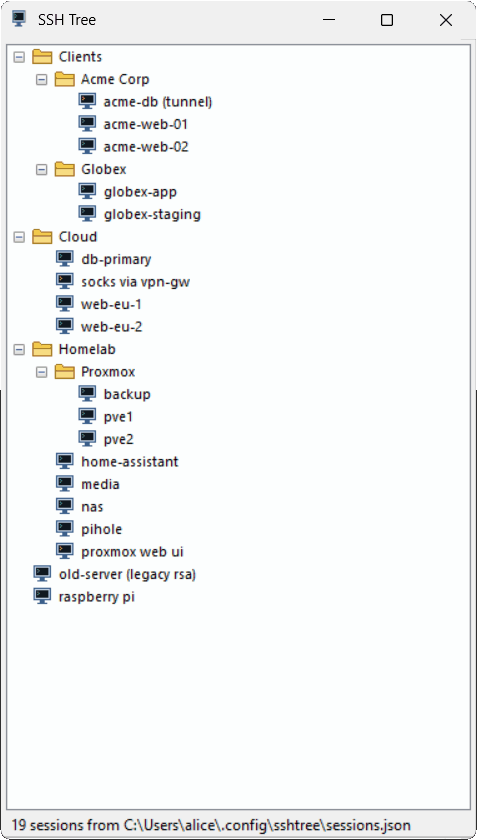
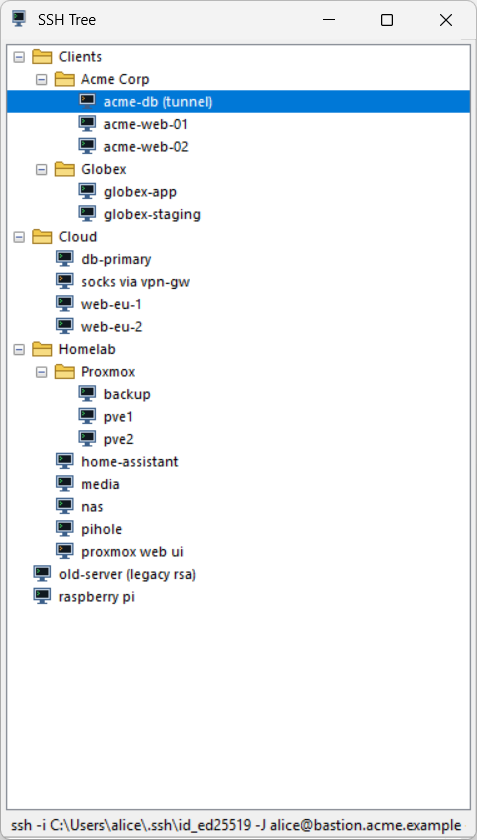
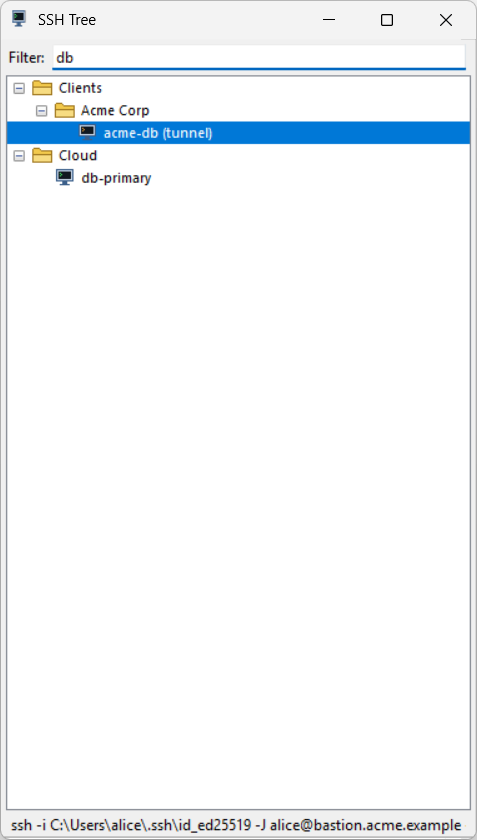
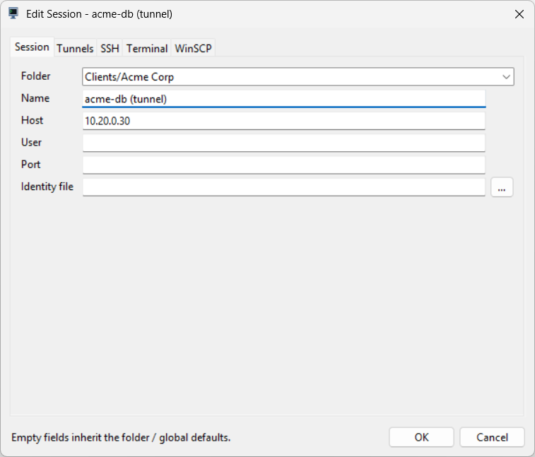
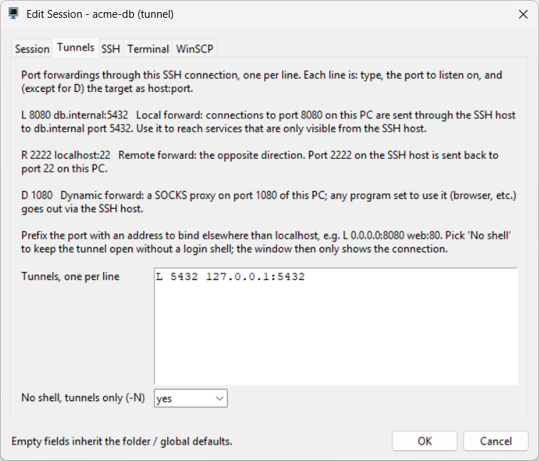

# SshTree

**A folder tree of SSH sessions. Any terminal. No stored passwords.**

[](../../releases/latest)
[](../../actions/workflows/ci.yml)
[](LICENSE)


A small, fast session launcher for OpenSSH in the spirit of *PuTTY Session
Manager*: a folder tree of SSH sessions that opens in your terminal of choice,
configured in one JSON file, with no PuTTY and no stored passwords.

<p align="center">
  
</p>

<p align="center"><sub>Pick a session, start typing to filter, Enter opens it in your terminal.</sub></p>

* Single file, Python 3.9+ standard library only. Also available as a
  standalone Windows build (no Python needed).
* Sessions, folders, per-folder defaults and global defaults in one JSON file.
* Opens sessions in Windows Terminal, the classic console, Terminal.app,
  iTerm, gnome-terminal, konsole and others, or any custom command template.
* Port forwardings (`-L`, `-R`, `-D`), jump hosts (`-J`), remote commands,
  arbitrary `-o` options, agent and X11 forwarding, "tunnels only" sessions.
* Launch a session in WinSCP on Windows.
* Works with any hotkey tool: a second launch brings the running window to the
  front, so bind your favourite key to it.
* Imports PuTTY sessions and PuTTY Session Manager folders from the registry.
* Keys and agents only. No password is ever stored.

## Install

**Windows, no Python:** download `SshTree-vX.Y.Z-windows-x64.zip` from the
[releases page](../../releases), unpack it anywhere and run `SshTree.exe`. The
folder also contains `sshtree-cli.exe` for the command-line options.

**From source (Windows, macOS, Linux):** clone the repository and run
`python sshtree.py`. On Windows `SshTree.cmd` starts it without a console
window. Nothing needs to be installed.

On first start an example config is written to
`~/.config/sshtree/sessions.json`; edit it or add sessions through the GUI.

## Using the GUI

<p align="center">
  
  
</p>

Right-click gives the session menu: New Session, Launch Session, Launch Folder
(and Subfolders), Launch WinSCP, Refresh, Expand and Collapse, Sort By, Lock
Session Tree and Session Management (edit, duplicate, copy ssh command, move,
delete, folders, open the config file).

Sessions can be dragged between folders. The status bar shows the exact ssh
command of the selected session. Just start typing (or press Ctrl+F) to open
the filter bar; it narrows the tree by name, host or user. The config file is
re-read automatically when it changes on disk.

| Key | Action |
| --- | --- |
| Enter / double-click | Launch session |
| Ctrl+W | Launch WinSCP |
| Ctrl+N / Ctrl+E | New / edit session |
| Ctrl+C | Copy ssh command |
| Del, F2 | Delete, rename folder |
| F5 | Reload config |
| Home / End | First / last visible row |
| Ctrl+Right / Ctrl+Left | Expand / collapse all |
| Ctrl+F, or just typing | Open the filter bar |
| Enter or Down in the filter | Select the first match; Enter again launches it |
| Esc | Clear the filter, then hide the bar, then close the window |
| Ctrl+Q | Exit |

<p align="center">
  
  
</p>

Window size, sort order, lock state and expanded folders are kept in
`state.json` next to the config, so the sessions file only changes when
sessions change.

## The config file

```json
{
  "defaults": {
    "user": "alice",
    "identity_file": "~/.ssh/id_ed25519",
    "options": {"ServerAliveInterval": 30},
    "hold_on_exit": "error",
    "terminal": "auto"
  },
  "tree": [
    {"name": "nas", "host": "nas.lan"},
    {
      "name": "Proxmox",
      "defaults": {"user": "root", "identity_file": "~/.ssh/homelab"},
      "children": [
        {"name": "pve1", "host": "10.0.10.11"},
        {"name": "pve2", "host": "10.0.10.12"}
      ]
    },
    {
      "name": "db tunnel",
      "host": "bastion.example",
      "no_shell": true,
      "tunnels": ["L 5432 db.internal:5432", "D 1080"]
    }
  ]
}
```

`tree` is a list of nodes. A node with a `children` list is a folder; any
other node is a session. Folders may carry a `defaults` object that applies to
everything below them. Settings are resolved as: global `defaults`, then each
folder's `defaults` from the outside in, then the session itself. `options`
dictionaries are merged; `tunnels`, `extra_args` and `winscp_args` lists are
concatenated; every other key is overridden.

`SSHTREE_CONFIG` in the environment or `--config FILE` selects another config
file. See [docs/demo-sessions.json](docs/demo-sessions.json) for a larger
example.

### Session and defaults keys

| Key | Meaning |
| --- | --- |
| `name` | Label in the tree (sessions) or folder name. Required. |
| `host` | Hostname or IP. Required for a session. |
| `user` | Login user. Omit to let ssh decide (`~/.ssh/config`, current user). |
| `port` | TCP port. `22` is not passed explicitly. |
| `identity_file` | Private key, `-i`. `~` and environment variables are expanded. May be a list; ssh then offers the keys in that order. |
| `jump_host` | ProxyJump target, `-J user@host[:port]`. |
| `options` | Object of `-o Key=Value` pairs. `true`/`false` become `yes`/`no`. |
| `tunnels` | List of port forwards, see below. |
| `extra_args` | Extra ssh arguments, list or string. |
| `command` | Remote command to run instead of a shell. |
| `agent_forwarding` | `true` adds `-A`. |
| `x11` | `true` adds `-X`. |
| `no_shell` | `true` adds `-N` (tunnels only). Shown with an orange icon. |
| `verbose` | `true` adds `-v`. |
| `title` | Terminal tab title; defaults to `name`. |
| `hold_on_exit` | `error` (default), `always` or `never`. `error` keeps the terminal open only when ssh itself fails (exit code 255: connection, host key, authentication), never after a plain `exit` or Ctrl+C. |
| `terminal` | `auto`, a preset name, or a custom template list (below). |
| `terminal_path` | `auto` or the terminal executable to use for the preset, e.g. a portable `WindowsTerminal.exe`. |
| `ssh_path` | The ssh executable. `auto` (default) uses the built-in Windows OpenSSH when present; `ssh` takes whatever is first on the PATH; or a full path. |
| `winscp_path` | `auto` or the full path to `WinSCP.exe`. |
| `winscp_protocol` | `sftp` (default) or `scp`. |
| `winscp_key` | Key file for WinSCP (`.ppk`). See WinSCP below. |
| `winscp_args` | Extra WinSCP command-line arguments. |
| `close_action` | `exit` (default) or `hide`: what the window close button does (`defaults` only). |
| `font` | Tree font, e.g. `"Segoe UI 9"`; default is the system font at 8pt (`defaults` only). |

Unknown keys are ignored, so you can keep notes in the file.

### Tunnels

Each entry is a short string or an object:

```json
"tunnels": [
  "L 8080 localhost:80",
  "R 2222 localhost:22",
  "D 1080",
  "L 127.0.0.1:5432 db.internal:5432",
  {"type": "local", "listen": "3306", "target": "mysql.internal:3306"}
]
```

Types are `L`/`local`, `R`/`remote` and `D`/`dynamic`. `listen` may include a
bind address. The compact ssh form `L 8080:localhost:80` also works. A session
with `no_shell` keeps the tunnels open without a login shell.

### Terminals

`terminal` is `auto` by default: Windows Terminal when found (PATH, Store
alias, or a portable install under `%USERPROFILE%\Programs\WindowsTerminal`,
`%LOCALAPPDATA%\Programs\WindowsTerminal` or `%ProgramFiles%\WindowsTerminal`),
otherwise a classic console; Terminal.app on macOS; the first of
gnome-terminal, konsole, xfce4-terminal, kitty, alacritty, wezterm, foot,
x-terminal-emulator, xterm on Linux. Presets: `wt` (new tab in the last used
window), `wt-window`, `console`, `macos-terminal`, `iterm`, `gnome-terminal`,
`konsole`, `xfce4-terminal`, `kitty`, `alacritty`, `wezterm`, `foot`,
`x-terminal-emulator`, `xterm`.

`terminal_path` swaps the executable of whichever preset is in use. A custom
template is a list of arguments: `{title}` is replaced inside any element, an
element that is exactly `{cmd}` is replaced by the ssh command's arguments, and
`{cmdline}` by the shell-quoted command as one string:

```json
"terminal": ["wt", "-w", "0", "new-tab", "--title", "{title}", "{cmd}"]
```

Inside the terminal, ssh runs through the program's own small runner
(`--exec`), which implements `hold_on_exit` and makes sure the tab closes
cleanly after `exit` or Ctrl+C.

### Keys and agents

Set `identity_file` globally, per folder or per session, or give a list of
keys. Agent forwarding (`-A`) and agent authentication need an SSH agent: on
Windows that is the OpenSSH agent service or Pageant 0.78+ started with
`pageant --openssh-config %USERPROFILE%\.ssh\pageant.conf` plus
`Include pageant.conf` at the top of `~/.ssh/config`. The built-in Windows
OpenSSH (which `ssh_path: auto` prefers) can use such an agent; Git's MSYS
ssh cannot.

### WinSCP (Windows)

*Launch WinSCP* opens `sftp://user@host:port/` in WinSCP. The key is chosen in
this order: `winscp_key`, a `.ppk` next to `identity_file`, then
`identity_file` itself (WinSCP offers to convert OpenSSH keys). With no key
WinSCP falls back to Pageant or asks for a password, which is never stored. A
`jump_host` becomes a WinSCP tunnel.

## Launching with a hotkey

The app registers no hotkey itself. Bind the key in whatever you already use
and point it at the program; the running window is activated, or the app is
started if it is not running. AutoHotkey v1 example for the packaged build:

```ahk
^!+P::
    Run "C:\Tools\SshTree\SshTree.exe"
return
```

and for the source version: `Run pyw -3 "C:\path\to\sshtree.py"`. Other
launchers work the same way (a Windows shortcut with a "Shortcut key", GNOME
or KDE custom shortcuts, macOS Shortcuts.app, skhd). The window is forced to
the front even when the launcher still holds the Windows foreground lock; if
that ever fails, `foreground.log` next to the config says why.

`close_action: "hide"` keeps the app running invisibly when the window is
closed, so the next hotkey press shows it instantly. To have it waiting from
login, autostart `SshTree.exe --hidden`.

Starting the program while a window is already open just brings that window
to the front and exits (a localhost socket; port and token in
`instance.json` next to the config). `--new-instance` forces a second window.

## Command line

```
sshtree-cli --list                  # list sessions and exit
sshtree-cli --print NAME            # show the ssh command for a session
sshtree-cli --launch NAME           # open the session in a terminal
sshtree-cli --winscp NAME           # open the session in WinSCP (Windows)
sshtree-cli --config FILE ...       # use another config file
sshtree-cli --write-example FILE    # write the example config
sshtree-cli --import-putty [...]    # import PuTTY sessions (see below)
SshTree --hidden                    # start in the background
```

`NAME` is a path like `Clients/Acme Corp/acme-web-01` or a bare session name.
From source, replace `sshtree-cli` with `python sshtree.py`.

## Importing PuTTY sessions

`import_putty_registry.py` (or `sshtree-cli --import-putty`) reads the PuTTY
sessions from the registry, including the folders that PuTTY Session Manager
stores in each session's `PsmPath` value, and writes them into the config:

```
python import_putty_registry.py --dry-run     # show the result only
python import_putty_registry.py               # replace the tree (keeps a .bak)
python import_putty_registry.py --merge       # add sessions that are missing
python import_putty_registry.py --output F    # write to another file
```

Mapped: host and login (`user@host` host names are split), port, port
forwardings, remote command, agent and X11 forwarding, no-shell, compression
and keep-alive settings. Values shared by nearly all sessions are moved to
`defaults`. PuTTY `.ppk` keys are mapped to the OpenSSH key of the same base
name in the same folder when it exists, otherwise kept as `winscp_key` with a
`_note`. Proxy settings become a `_note`, since OpenSSH wants them as
`jump_host` or `options.ProxyCommand`. Terminal appearance is not imported.

## Development

```
pip install -r requirements-dev.txt     # black, isort, pillow, pyinstaller
python tests/smoke_test.py              # builders, importer, and a scripted GUI run
python docs/make_screenshots.py         # README screenshots (Windows)
python tools/make_icon.py               # assets/sshtree.ico
pyinstaller --noconfirm sshtree.spec    # dist/SshTree/ with both executables
```

Releases are built by GitHub Actions: pushing a tag `vX.Y.Z` (matching
`__version__` in `sshtree.py`) builds the Windows package and attaches it to a
GitHub release. See [CHANGELOG.md](CHANGELOG.md).

## License

[MIT](LICENSE)
